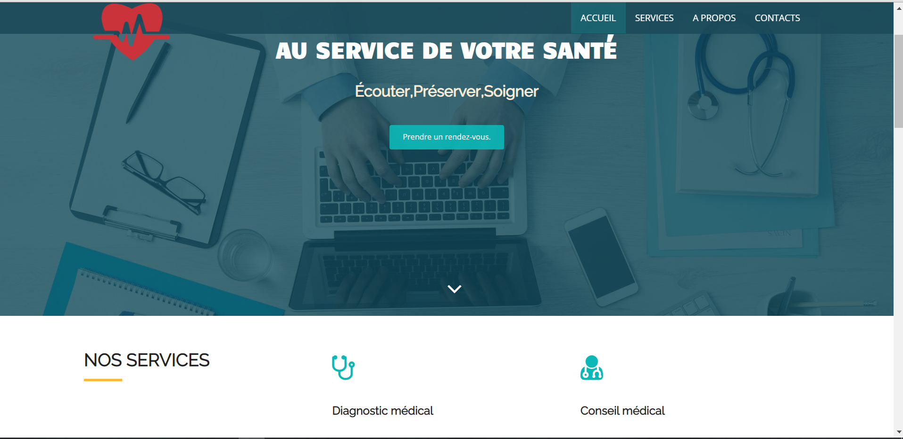
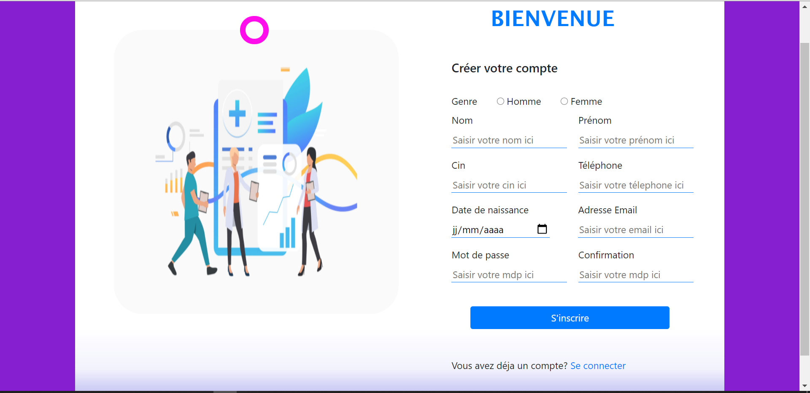
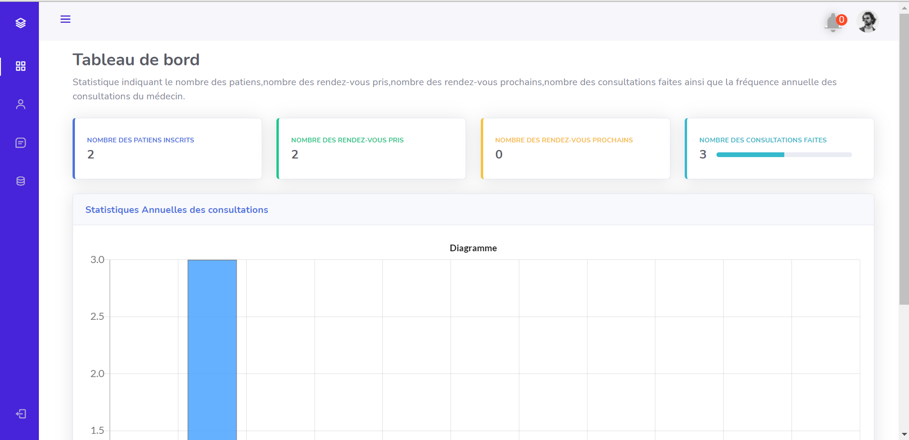
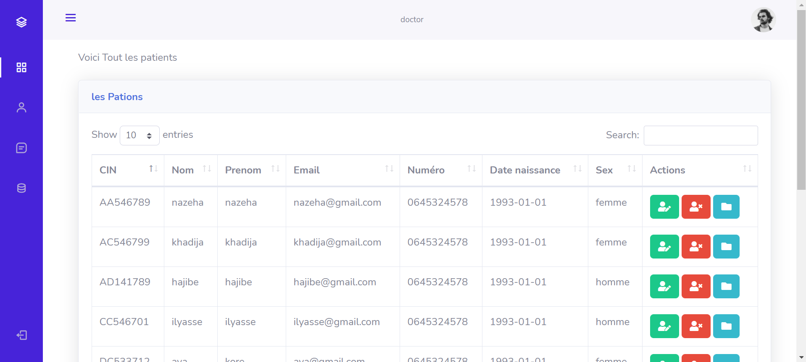
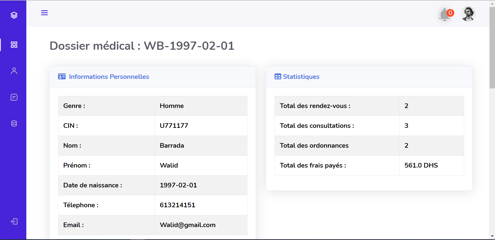
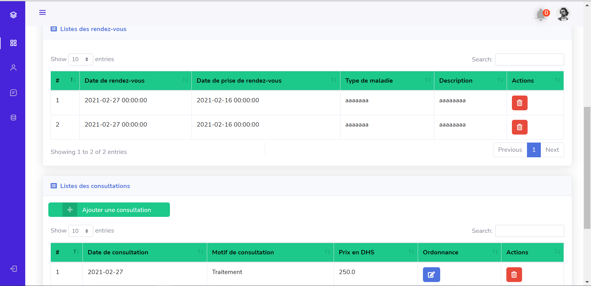
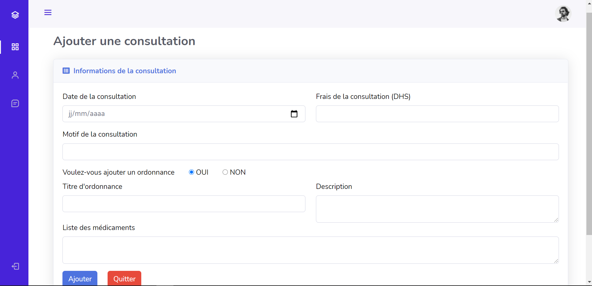
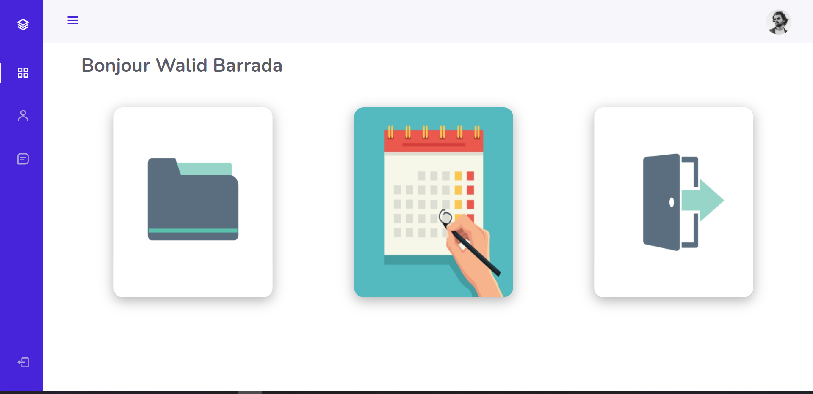
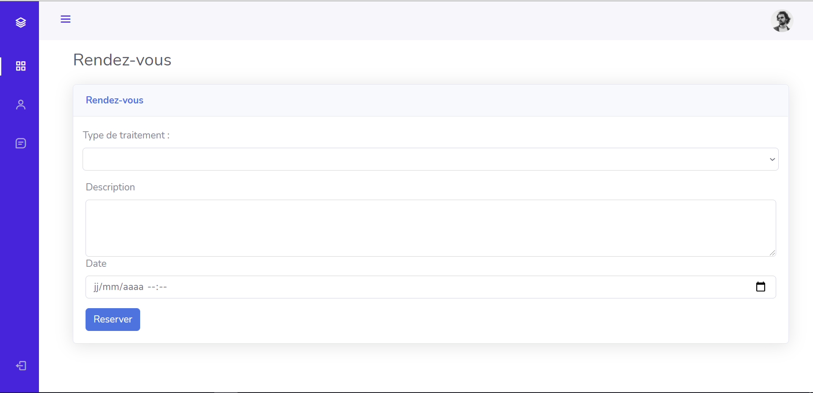

# ***Aplicación de gestión de consultorio médico***

#### **Colaboradores :**
Este proyecto fue realizado con la colaboración de :
  
  * [Ayoub HMADOUCH ](https://github.com/AyoubHmadouch)
  * [Abdessamad EL HAFI](https://github.com/abdoelhafi)
  * [FOUAD EL FAKHORI](https://github.com/fFakhori)
  * [Abderahmane KOTBI](https://github.com/abdorah)

#### **Supervisado por** 
* Prof. Mahmoud EL HAMLAOUI

---
### **Objetivo del proyecto:**
El objetivo de este proyecto es concebir y desarrollar una aplicación que permita la gestión de un consultorio médico (toma de citas en línea, gestión de pacientes, ...), utilizando la plataforma de desarrollo JAVA EE.

---
### **Herramientas de desarrollo**

<table>
    <thead>
        <th>Front-end</th>
        <th>Back-end</th>
        <th>Diseño</th>
        <th>Otros</th>
    </thead>
    <tbody>
        <tr>
            <td>HTML</td>
            <td>Java EE (Tomcat server,Servlet,Jsp,MVC,DAO,JUnit)</td>
            <td><a href=https://www.planttext.com/">planttext</a></td>
             <td>Git/Github</td>
        </tr>
        <tr>
            <td>CSS</td>
            <td>MySQL (SGBD)</td>
            <td></td>
              <td>Docker</td>
        </tr>
         <tr>
            <td>Javascript</td>
            <td></td>
            <td></td>
              <td>Docker-composer</td>
        </tr>
        <tr>
            <td>Bootstrap</td>
            <td></td>
            <td></td>
             <td></td>
        </tr>
    </tbody>
</table>

---


### **Interfaces de la aplicación**
* **Inicio**
  
 

* **Registro**



* **Autenticación**


* **Panel de control del médico**



* **Lista de pacientes**



* **Expediente médico del paciente**




* **Agregar una consulta por el médico**



* **Inicio del paciente**




* **Agendar una cita por el paciente**




## Cómo usar este proyecto

Para ejecutar esta aplicación, ejecute el siguiente comando:

```sh
docker compose -f 'docker-compose.yml' up -d --build 
```
